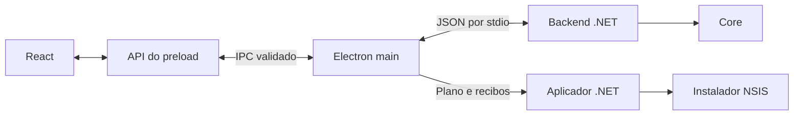

# Arquitetura

O produto ativo é um aplicativo Electron para Windows x64. React apresenta os dados, o processo principal do Electron integra a área de trabalho e o backend .NET controla os scripts. O aplicador de atualizações é um executável independente.

## Projetos ativos

| Caminho                                      | Responsabilidade                                                                                                                                               |
| -------------------------------------------- | -------------------------------------------------------------------------------------------------------------------------------------------------------------- |
| `Presentation.Electron/src/renderer`         | Páginas, componentes Fluent UI, seleção e rascunhos de edição. Recebe snapshots e solicita ações pela API do preload.                                          |
| `Presentation.Electron/src/preload/index.ts` | Expõe a API limitada `window.ahkManager` por `contextBridge`.                                                                                                  |
| `Presentation.Electron/src/shared`           | Contratos TypeScript, validação das mensagens e textos usados pelo host.                                                                                       |
| `Presentation.Electron/src/main`             | Janela, bandeja, diálogos, IPC, conexão com o backend, elevação e atualização.                                                                                 |
| `Backend/AhkManager.Backend.csproj`          | Executável `AhkManager.Backend`. Autentica o host, valida o protocolo e coordena migração, elevação e transferência de inicialização.                          |
| `Core/AhkManager.Core.csproj`                | Biblioteca `AhkManager.Core`, com modelos, persistência, análise AHK, observação de processos e regras das operações. Não depende de projetos de apresentação. |
| `UpdateHost/AhkManager.UpdateHost.csproj`    | Executável `AhkManager.UpdateHost`. Valida o plano, aguarda a saída do Manager e aplica ou restaura a instalação. Não acessa a rede.                           |
| `Tests.Backend`                              | Testes de backend, `Core/` e adaptadores de `Fixtures/`.                                                                                                       |
| `Presentation.Electron/tests`                | Testes Node e harness de apresentação com dados sintéticos.                                                                                                    |

`src/main/desktop/` integra tema, bandeja, diálogos e diagnóstico da janela. `src/main/ipc/` concentra o registro e a política das mensagens. `src/main/updates/` reúne consulta, download, cache, confirmação de encerramento e aplicação de atualizações. `application-updates.ts` compõe esses serviços. `src/main/index.ts` inicia `application.ts`, que coordena a sessão do aplicativo. `src/main/controller/` separa seleção, identidade, políticas e o lote de parada dos scripts. Esses caminhos são relativos a `Presentation.Electron/`.

`Bezoro.AhkManager.sln` contém Core, Backend, UpdateHost e Tests.Backend. Os três executáveis .NET usam `net10.0-windows`; os publicados são autossuficientes para `win-x64`.

## Caminho de uma operação

1. O renderer envia uma solicitação com os dados da seleção pela API do preload.
2. O processo principal valida a origem da mensagem e os argumentos. `ManagerController` coordena confirmações e ações nativas, como editar ou enviar um arquivo à Lixeira.
3. `main/backend.ts` conversa com `Backend/StdioHost.cs` por frames JSON com tamanho limitado. O handshake comprova o processo pai e vincula a sessão. Contratos C# ficam em `Backend/Protocol.cs` e o registro de serialização em `Backend/ProtocolJsonContext.cs`.
4. `BackendSession` valida a ação e chama `Core/Services/ManagerService`. O serviço serializa as alterações pela mesma exclusão, confere seleção, identidade dos arquivos e processos, e registra operações antes dos efeitos que exigem recuperação.
5. O backend publica um novo `ManagerSnapshot`. O renderer mostra o estado observado e os motivos que impedem uma ação.

`Backend/Dispatch/` separa as ações comuns das negociações de autoridade. `Backend/Administration/` reúne a transferência administrativa; `Backend/Startup/`, a adoção de uma continuação. `Backend/Transport/` compartilha o framing dos canais privados.

Iniciar e reiniciar dependem da validação do interpretador e do script. Parar solicita saída normal e exige observação do encerramento. Um resultado incerto permanece pendente; recuperar confere o estado e preserva evidências, sem repetir a execução.

`ManagerService` é uma classe parcial. O arquivo central mantém composição, estado compartilhado e exclusão. Os arquivos `ManagerService.Catalog`, `.Settings`, `.Files`, `.Operations`, `.Observation`, `.Recovery`, `.Startup` e `.StartupContinuation` agrupam as respectivas operações. Uma nova classe parcial continua usando a mesma autoridade e exclusão.

## Inicialização e elevação

O backend recebe o caminho comprovado do host Electron e compõe o serviço com `CreateForTrustedStartupHost`. O perfil novo prefere iniciar com Windows e como administrador. `UserStartupService` reconcilia essa intenção com uma entrada Run normal ou uma tarefa agendada por usuário.

A troca de privilégio usa comprovantes de processo, recibos e confirmação de transferência entre instâncias. A continuação de login vincula o perfil, os arquivos e a sessão. Seus arquivos JSON são evidências de recuperação; eles sozinhos não autorizam execução. O código está nos módulos de elevação e adoção do Backend e em `ManagerService.StartupContinuation`.

## Dados e compatibilidade

| Local                                                                       | Conteúdo                                                                  |
| --------------------------------------------------------------------------- | ------------------------------------------------------------------------- |
| `%LOCALAPPDATA%/Bezoro/AhkManagerElectron`                                  | `settings.json`, `operations.json`, atividade e registros de continuação. |
| `%APPDATA%/Bezoro/AhkManagerElectron/Chromium`                              | Armazenamento separado do Chromium.                                       |
| `%LOCALAPPDATA%/Bezoro/AhkManagerElectron/Updates/installers/<version>`     | Instalador preservado e `receipt.json` com versão, protocolo e hash.      |
| `%LOCALAPPDATA%/Bezoro/AhkManagerElectron/Updates/operations/<operationId>` | Plano, recibos, resultado e cópias da operação de atualização.            |

`Core/Models/StateDocuments.cs` define os documentos versionados e `Core/Models/ManagerJson.cs` registra sua serialização. `Core/Services/ContinuationJson.cs` atende aos registros de continuação. `Backend/ProtocolJsonContext.cs` registra os tipos usados entre Electron e backend. A reflexão JSON está desativada no Core e no Backend; acrescente tipos ao contexto correspondente quando alterar um contrato.

Mover um tipo para `Bezoro.AhkManager.Core.*` não muda o JSON. Nomes de propriedades, valores dos enums, opções de serialização e versões de esquema continuam sendo contratos. Os hashes das continuações também dependem desses bytes. Alterações nesses formatos precisam tratar leitura de perfis anteriores e recuperação.

Nomes históricos como o valor Run `Bezoro.AhkManager.WinUI`, o perfil `AhkManagerWinUI` e a identidade do mutex são deliberados. Não os substitua por causa do namespace atual. A migração do perfil WinUI e a importação do catálogo antigo têm prévia e confirmação próprias em `Backend/ProfileMigrationService.cs` e `Core/Services/LegacyImportService.cs`.

## Atualizações e distribuição

O processo principal consulta as Releases do repositório fixo, valida os manifestos e usa `electron-updater` para baixar e conferir o pacote. A aplicação só começa após uma ação explícita, o encerramento confirmado do backend e a saída normal do Manager. O UpdateHost preserva a instalação e seus registros antes do NSIS e restaura essa cópia após uma falha confirmada. Os scripts permanecem em execução.

`UpdateHost/Runtime/` contém a sequência de aplicação e seus efeitos. `UpdateHost/Storage/` valida pacotes, perfis, registros e cópias; `UpdateHost/Protocol/` define os planos e resultados. Os testes isolados ficam em `UpdateHost/SelfTests/`.

`Presentation.Electron/scripts/owned-files.cjs` gera a lista exata e os hashes dos arquivos instalados. `installer.nsh` usa esse inventário e o protocolo de atualização para validar instalação e remoção. `tools/Build-Electron.ps1` e `tools/Package-Electron.ps1` produzem o pacote. O workflow `.github/workflows/windows-ci.yml` valida os projetos, captura a interface e ensaia atualização e retorno entre dois instaladores reais. [UPDATES.md](UPDATES.md) descreve o protocolo e a publicação.

## Código legado

`App/`, `Presentation.Wpf/`, `Presentation.WinUI/`, `Tests/`, `Tests.WpfUI/` e `Tests.WinUI/` preservam implementações e testes anteriores. Estão fora da solução e do pacote Electron. `tools/Build-WinUI.ps1`, `tools/Package-WinUI.ps1` e `tools/Run-SafeTests.ps1` pertencem àquele caminho histórico.

O código ativo não deve compilar fontes das pastas legadas nem depender de seus projetos. A interface WinUI pode consumir Core para manter as fontes históricas compiláveis. As permissões `InternalsVisibleTo` do Core nomeiam seus consumidores .NET e testes explicitamente; mudar nomes de assembly exige atualizar essas permissões.
