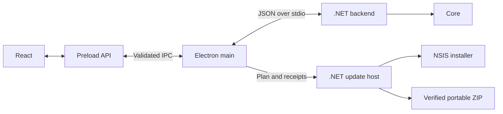

# Architecture

The active product is an Electron desktop app for Windows x64. React presents state, the Electron main process integrates with the desktop, and the .NET backend controls scripts. A separate executable applies updates.

## Active projects

| Path                                         | Responsibility                                                                                                       |
| -------------------------------------------- | -------------------------------------------------------------------------------------------------------------------- |
| `Presentation.Electron/src/renderer`         | Fluent UI pages, selection, and editing drafts; consumes snapshots through the preload API                           |
| `Presentation.Electron/src/preload/index.ts` | Exposes the limited `window.ahkManager` API through `contextBridge`                                                  |
| `Presentation.Electron/src/shared`           | TypeScript contracts, message validation, and host text                                                              |
| `Presentation.Electron/src/main`             | Window, tray, dialogs, IPC, backend connection, elevation, and updates                                               |
| `Backend/AhkManager.Backend.csproj`          | Authenticates the host, validates commands, and coordinates migration, elevation, and startup transfer               |
| `Core/AhkManager.Core.csproj`                | Models, persistence, AHK parsing, process observation, and operation rules; no presentation project dependency       |
| `UpdateHost/AhkManager.UpdateHost.csproj`    | Validates update plans, waits for confirmed manager exit, and applies or restores an installation; no network access |
| `Tests.Backend`                              | Backend and Core checks, with shared adapters under `Fixtures/`                                                      |
| `Presentation.Electron/tests`                | Node tests and the presentation harness                                                                              |

Within `Presentation.Electron`, `src/main/desktop/` owns theme, tray, dialogs, and window diagnostics. `src/main/ipc/` registers authenticated handlers and applies request policy. `src/main/updates/` owns release discovery, transport, download, cache, shutdown confirmation, and handoff. `application-updates.ts` composes the updater. `src/main/storage/` resolves the deployment and manages portable data moves. `src/main/index.ts` starts `application.ts`, the application coordinator. `src/main/controller/` separates selection, identity, policies, and stop-and-exit coordination.

`Bezoro.AhkManager.sln` contains Core, Backend, UpdateHost, and Tests.Backend. Active .NET projects target `net10.0-windows`; published executables are self-contained for `win-x64`.

## Operation flow

1. The renderer submits an action with its selection through the preload API.
2. The main process verifies the document lease, origin, and arguments. `ManagerController` coordinates confirmation and native actions such as editing or recycling a file.
3. `main/backend.ts` communicates with `Backend/StdioHost.cs` through bounded JSON frames. The handshake proves the parent process and binds the session. C# wire contracts are in `Backend/Protocol.cs`, with serialization registered in `Backend/ProtocolJsonContext.cs`.
4. `BackendSession` validates the action and calls `Core/Services/ManagerService`. The service serializes changes under one authority and lock, verifies file/process identities, and records operations before effects that require recovery.
5. The backend publishes a `ManagerSnapshot`; the renderer shows observed state and reasons an action is unavailable.

`Backend/Dispatch/` separates ordinary commands from authority negotiation. `Backend/Administration/` handles administrative transfer, `Backend/Startup/` handles continuation adoption, and `Backend/Transport/` provides framing for private channels.

Start and restart require a verified interpreter and script. Stop requests normal exit and observes its completion. Uncertain results remain pending. Recovery checks state and preserves evidence without replaying an operation.

`ManagerService` is a partial class. Its main file owns composition, shared state, and the lock. `.Catalog`, `.Settings`, `.Files`, `.Operations`, `.Observation`, `.Recovery`, `.Startup`, and `.StartupContinuation` group their respective operations while retaining that same authority.

## Startup and elevation

The backend receives the verified Electron host path and constructs the service through `CreateForTrustedStartupHost`. New profiles default to Windows startup and administrator mode. `UserStartupService` reconciles those preferences with a per-user Run entry or scheduled task.

Privilege transfer uses process proofs, receipts, and an authenticated handoff. Login continuation binds the profile, files, and session. Its JSON files are recovery evidence and do not authorize execution by themselves. See the Backend elevation/adoption modules and `ManagerService.StartupContinuation`.

## Data compatibility

| Location                                                      | Contents                                                                  |
| ------------------------------------------------------------- | ------------------------------------------------------------------------- |
| `%LOCALAPPDATA%/Bezoro/AhkManagerElectron`                    | Settings, operations, activity, and continuation records                  |
| `%APPDATA%/Bezoro/AhkManagerElectron/Chromium`                | Separate Chromium storage                                                 |
| `Updates/installers/<version>` below the operational root     | Preserved installer and receipt with its full version, protocol, and hash |
| `Updates/operations/<operationId>` below the operational root | Update plan, receipts, result, and backups                                |

`Core/Models/StateDocuments.cs` defines versioned documents; `ManagerJson.cs` registers serialization. `Core/Services/ContinuationJson.cs` handles continuation records. `Backend/ProtocolJsonContext.cs` registers Electron/backend wire types. JSON reflection is disabled in Core and Backend; add changed types to the appropriate context.

These AppData locations belong to the installed edition. In a portable deployment, `Core/Infrastructure/RuntimeProfileLayout.cs` and `main/storage/deployment.ts` derive the portable root from the actual Electron host under `App`. The selected data folder contains `Profile`, `Chromium`, and `Updates`. The root `portable.json` is bounded, has an exact schema, and survives application replacement. Renderer requests cannot supply a data path; only the main process's native picker can select one.

The native initializer checks the dedicated product container and selected data directory before Chromium starts. Backend initialization acquires effect ownership before importing an existing Electron profile. A data move prepares a private staging directory and intent, then copies and verifies closed operational data on the next normal restart. The pointer changes only after promotion. Source and recovery copies remain available, and an unverified source cannot authorize an empty-profile fallback.

A native child retains the portable root, selected data directory and their ancestors while the Manager is running. A separate migration lease retains the source and private staging directory during copying, releasing only the staging leaf for promotion. Both helpers derive paths from the authenticated parent and configuration. They accept no path arguments. Normal Manager exit waits for the runtime lease to close; a lost lease fails closed.

Moving a type to `Bezoro.AhkManager.Core.*` must not change persisted JSON. Property names, enum values, serialization settings, schema versions, and continuation hashes are compatibility contracts. Format changes need backward-reading and recovery coverage.

Historical names such as the Run value `Bezoro.AhkManager.WinUI`, the `AhkManagerWinUI` profile, and mutex identities are intentional. Keep them when changing namespaces or display text. WinUI profile migration and older catalog import have separate previews and confirmation in `Backend/ProfileMigrationService.cs` and `Core/Services/LegacyImportService.cs`.

## Updates and distribution

The main process checks a fixed public repository, validates release manifests, and uses `electron-updater` to download and verify installers. GitHub credentials are not part of the desktop updater. Updates require explicit user action, confirmed backend shutdown, and normal manager exit. UpdateHost backs up the installation and its registry entries before running NSIS, and restores them after a confirmed failure. Scripts remain running.

Portable updates use a separate protocol-2 manifest and bounded ZIP downloader. `PortableLauncher/` is the native root entry point; `App` contains the replaceable application. `UpdateHost/Portable/` validates the complete package inventory, stages files on the same volume, snapshots `App`, and promotes the new application without registry registration. It also replaces the root launcher and inventory while preserving `portable.json` and the selected data directory. Confirmed failures restore application files. Unknown results preserve evidence and block replay.

After a durable successful outcome, the helper removes only unchanged, verified duplicate workspaces beneath the portable root. The complete operation backup and cached packages remain in the data directory. Unexpected workspace contents or a failed cleanup preserve the remaining files; unknown and restored-failure outcomes never authorize cleanup.

When publisher policy is configured, a detached CMS signature binds the exact portable release manifest and its ZIP digest. The native signature verifier checks the configured publisher, certificate chain, code-signing usage, and digest. Installer Authenticode checks remain independent. Neither edition falls back from a required signature to hash-only verification.

Electron's Chromium network API and Node's fetch API handle manual redirects differently. Updater transport must expose redirects to the bounded, allowlisted release client instead of automatically following arbitrary destinations. This boundary needs tests using the real Electron runtime, in addition to protocol unit tests.

`UpdateHost/Runtime/` owns the apply sequence and effects; `Storage/` verifies packages, profiles, registry entries, and snapshots; `Protocol/` defines plans and results. Isolated checks live under `SelfTests/`.

`Presentation.Electron/scripts/owned-files.cjs` generates the inventory and hashes of installed files. `installer.nsh` uses that inventory and the update protocol to validate installation/removal. `tools/Build-Electron.ps1` and `tools/Package-Electron.ps1` produce the installed distribution. `Build-PortableLauncher.ps1`, `Build-PortablePackage.ps1`, and `New-PortableReleaseManifest.ps1` produce the portable family from the same application version and commit. Windows CI validates projects, captures the interface, and exercises real installed and portable update/rollback. See [UPDATES.md](UPDATES.md) for publication details.

## Historical code

`App/`, `Presentation.Wpf/`, `Presentation.WinUI/`, `Tests/`, `Tests.WpfUI/`, and `Tests.WinUI/` preserve earlier implementations and tests outside the active solution/package. Their build and safe-test scripts remain historical tools.

Active code must not compile sources from those archived folders or depend on their projects. The archived WinUI app may reference Core to keep its historical sources buildable. Core names its .NET consumers explicitly through `InternalsVisibleTo`; assembly-name changes must update those declarations.
