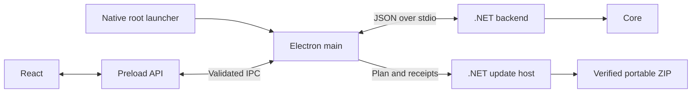

# Architecture

AHK Manager has one distribution: a portable Windows x64 application. React renders state, Electron main integrates with Windows, and the .NET backend controls scripts. A separate native host applies verified portable updates.

## Projects and dependencies

| Path                                                | Responsibility                                                                |
| --------------------------------------------------- | ----------------------------------------------------------------------------- |
| `Presentation.Electron/src/renderer`                | Fluent UI pages, selection and editing drafts                                 |
| `Presentation.Electron/src/preload`                 | Specific `window.ahkManager` methods exposed through `contextBridge`          |
| `Presentation.Electron/src/shared`                  | Contracts, runtime validators and shared text                                 |
| `Presentation.Electron/src/main`                    | Desktop composition, tray, dialogs, backend, storage and updates              |
| `Backend/`                                          | Authenticated host session, bounded commands and startup/profile coordination |
| `Core/`                                             | Models, persistence, AHK parsing, process observation and operation rules     |
| `PortableLauncher/`                                 | Native root entry point and execution-level manifest                          |
| `UpdateHost/`                                       | Offline portable package validation, application, rollback and recovery       |
| `Tests.Backend/` and `Presentation.Electron/tests/` | Isolated domain, transport and presentation checks                            |

`Bezoro.AhkManager.sln` contains Core, Backend, UpdateHost and Tests.Backend. Active .NET projects target `net10.0-windows`; published executables are self-contained for `win-x64`. Core has no presentation dependency. UpdateHost source-links only the BCL-only `Core/Infrastructure/WindowsStoragePath.cs` policy, keeping its executable independent of Core assemblies.

Electron `main/desktop/` owns Windows integration, `main/ipc/` authenticates renderer requests, `main/storage/` resolves portable data and coordinates moves, and `main/updates/` owns release discovery through update handoff. `application.ts` composes those services. The renderer has no filesystem, process or Node access.

## Commands and process effects

1. The renderer submits a specific action through preload.
2. Main verifies the document lease, origin and arguments. `ManagerController` coordinates selection and native actions.
3. `main/backend.ts` exchanges bounded JSON frames with `Backend/StdioHost.cs`. The handshake proves the parent process and binds the session.
4. `BackendSession` validates the command and calls `Core/Services/ManagerService` under its single authority and mutation lane.
5. The backend publishes observed state; the renderer shows results and reasons an action is unavailable.

Start and restart require a verified interpreter and script. Stop requests normal exit and observes completion. Uncertain effects remain pending, retain their evidence and are never replayed automatically.

`ManagerService` partial files share one lock and owner. Catalog, settings, files, operations, observation, recovery, startup and continuation code remain separate without creating independent authorities. C# wire types belong in `Backend/Protocol.cs` and its JSON context; domain documents belong in `Core/Models` and `ManagerJson`.

## Windows startup and elevation

Both the root launcher and packaged Electron executable carry `requireAdministrator` manifests with `uiAccess=false`. Windows enforces this before app initialization. Backend and UpdateHost inherit their authenticated parent's token; their identity checks remain independent of manifest metadata.

The trusted desktop composition uses `CreateForTrustedStartupHost` and makes Manager administrator mode mandatory. It normalizes the compatible preference field before startup comparison and persistence while preserving the Windows-startup opt-out and every script's own privilege choice. Enabled Windows startup uses a current-user scheduled task with highest privileges.

Task ownership requires the product marker, resolved Windows account, exact command, logon mode and task shape. Working-directory readiness is separate from ownership. The reviewed legacy Run-entry repair binds approval to exact task/registry/settings state and saves a durable backup before deletion. Unknown or concurrently replaced entries remain protected.

Normal-to-administrator coordination and startup continuation retain authenticated process proofs, receipts and recovery evidence for compatible sessions. A JSON receipt alone never authorizes execution. The mandatory manifest does not weaken account, session, ACL or file-identity checks.

## Portable data and compatibility

The actual Electron host under `App` identifies its root launcher and bounded `portable.json`. The selected data folder contains `Profile`, `Chromium`, `Updates` and `Logs`; `Data` beside the root launcher is the default. The application payload is replaceable, while the selected data path and profile remain separate.

The native initializer verifies the dedicated product root and selected data directory before Chromium opens them. Local NTFS is required. Recognized hydrated Windows Cloud Files tags are inspected through no-follow metadata handles; junctions, symlinks, unknown tags and files requiring recall are refused. External scripts can live elsewhere and are not restricted to the data volume.

A native child retains the root, selected data folder and ancestors during runtime. Data moves use a separate lease, private staging, verified copying and pointer promotion on a normal restart. Source and recovery copies are retained. Renderer input cannot supply paths; only main's native picker can select a destination.

Historical data import remains a compatibility feature: a first portable launch can copy a verified previous Electron profile without modifying its source. Explicit older profile/catalog import retains previews and confirmation. Persisted names such as `Bezoro.AhkManager.WinUI`, schema fields and mutex identities must not be renamed as cleanup, because current user data and startup ownership still depend on them.

JSON reflection is disabled. A contract change must update its source-generated context and runtime validator. Preserve property names, enum values, schema versions, hashes and raw-file concurrency fingerprints unless a tested migration changes them.

## Portable updates

The public GitHub client accepts protocol-2 portable manifests and bounded ZIP packages. It validates exact version, source commit, sizes and hashes before caching or application. A configured publisher policy also requires a detached CMS signature; required signatures never fall back to hash-only verification.

The helper derives paths from the authenticated parent and portable layout, then verifies the plan and shutdown receipts. It waits for backend exit and normal Manager exit, snapshots application files, stages the complete package on the same volume, and promotes it. The root launcher and inventory are updated while `portable.json` and the selected data folder are preserved. Confirmed failures restore the previous application. Unknown outcomes preserve evidence and block replay.

Protocol 2 and existing portable clients retain some historical field names and `Updates/installers/<version>/archive.zip`. These identify portable ZIPs and their receipts, not an executable installer. Preserve them until an explicit portable-data/protocol migration replaces them.

After a durable successful outcome, cleanup removes only unchanged verified workspaces. The complete recovery backup and cached versions stay in the selected data folder. Unexpected contents or failed cleanup preserve the remaining files.

`Presentation.Electron/scripts/owned-files.cjs` builds the payload inventory. Packaging produces an unpacked application, native launcher and versioned portable ZIP from one exact version and source commit. Publication uploads the portable manifest, ZIP and configured signature as one immutable family. Windows CI validates native policies, the interface and real portable update/rollback. See [UPDATES.md](UPDATES.md).
